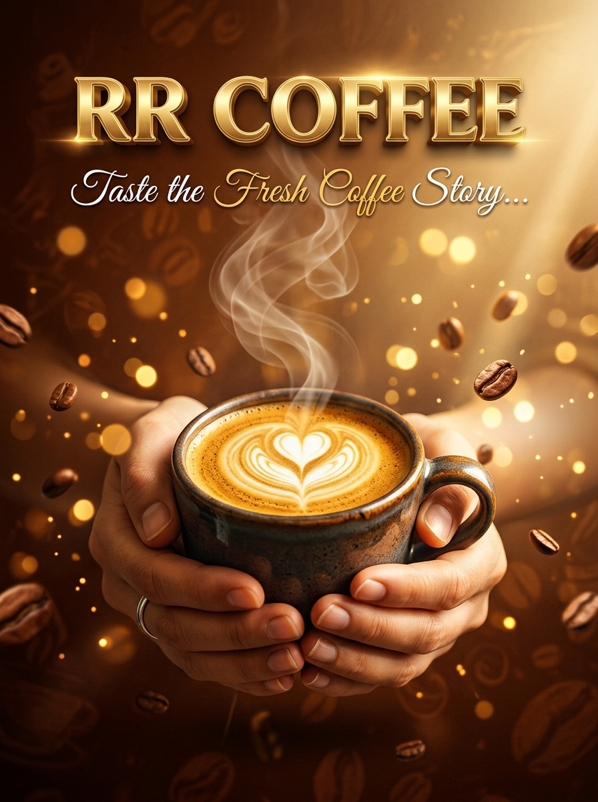
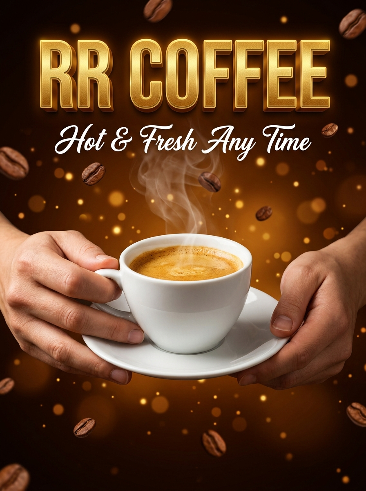
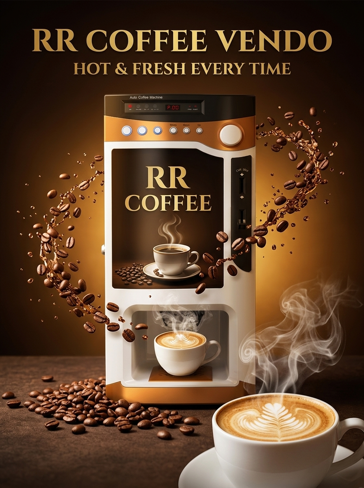
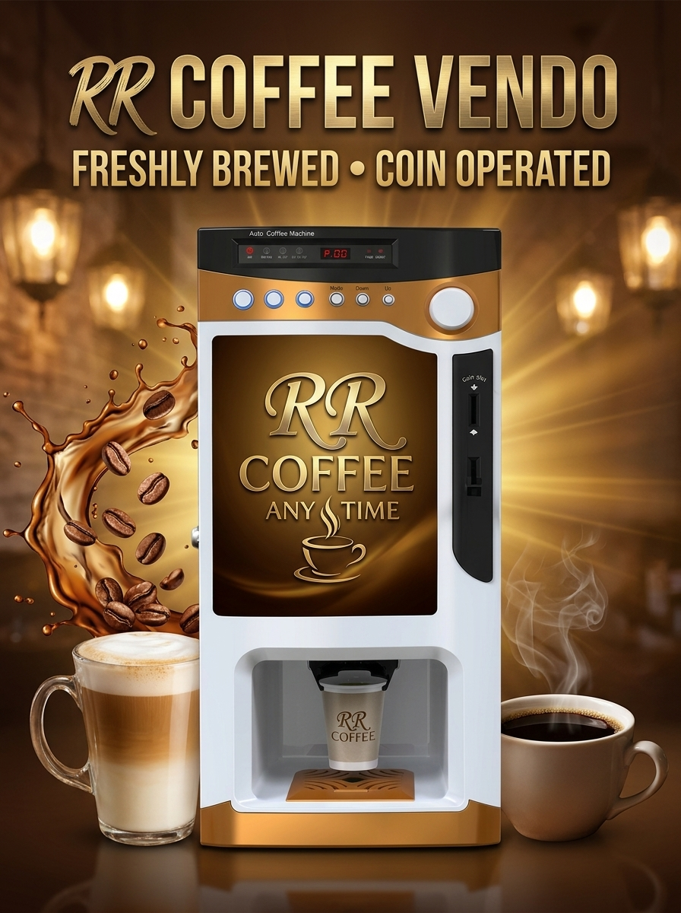

# Photo Design - RR Coffee Vendo Signage

Collection of photo designs and marketing materials for **RR Coffee Vendo**, ready for A4 photo paper printing.

## 📄 Print-Ready A4 Signage (Pure Graphic Artwork)

These are standalone full-bleed vertical graphic designs formatted for **A4 photo paper printing** (no machine body/casing, designed to be inserted into the front lightbox panel or displayed as a counter poster):

| Preview | Filename | Description |
| :---: | :--- | :--- |
|  | `RR_Coffee_A4_Signage_Option1.jpg` | **Primary A4 Poster (Artisan Edition):** Luxurious 3D golden "RR COFFEE" typography, "Taste the Fresh Coffee Story..." tagline, hands warmly holding a steaming hot ceramic mug with heart latte art, floating coffee beans and warm amber bokeh. |
|  | `RR_Coffee_A4_Signage_Option2.jpg` | **Alternative A4 Poster (Classic Cup & Saucer):** Bold golden "RR COFFEE" with "Hot & Fresh Any Time" tagline, hands holding a classic porcelain cup with espresso crema, rich roasted coffee beans background. |

---

## ☕ 3D Machine Mockup / Promo Banners

| Preview | Filename | Description |
| :---: | :--- | :--- |
|  | `RR_Coffee_Vendo_Signage_1.jpg` | Studio Luxury machine showcase with RR COFFEE branding. |
|  | `RR_Coffee_Vendo_Signage_2.jpg` | Cafe Kiosk commercial advertising showcase. |

## 🖨️ Printing Instructions (A4 Paper)
1. Open `RR_Coffee_A4_Signage_Option1.jpg` (or Option 2) on your computer.
2. Select **Print** (`Ctrl + P`).
3. Set Paper Size to **A4** (210 × 297 mm).
4. Choose **Fit to Printable Area** or **Borderless Photo Printing** with **High Quality / Photo Glossy** paper setting.
